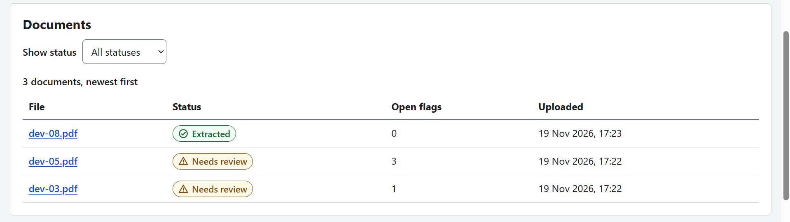
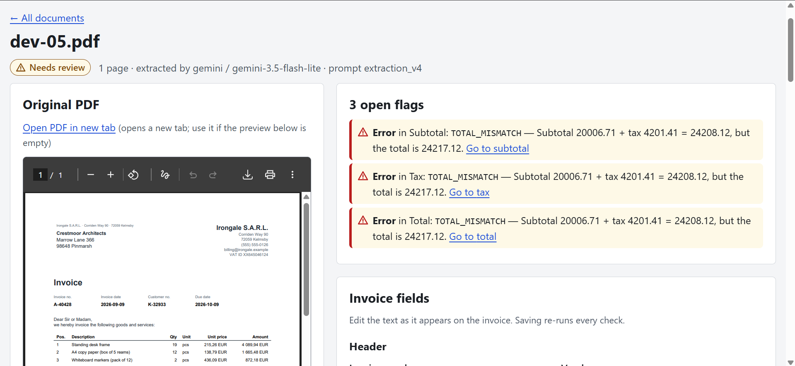
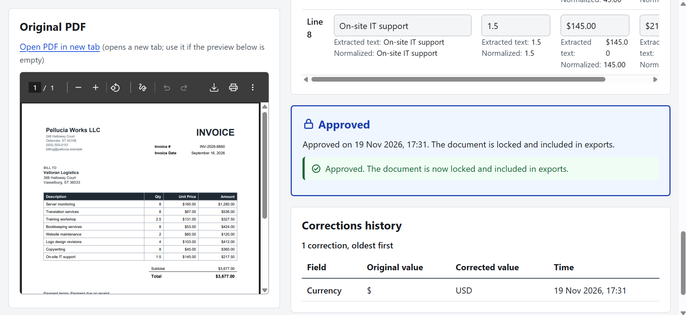
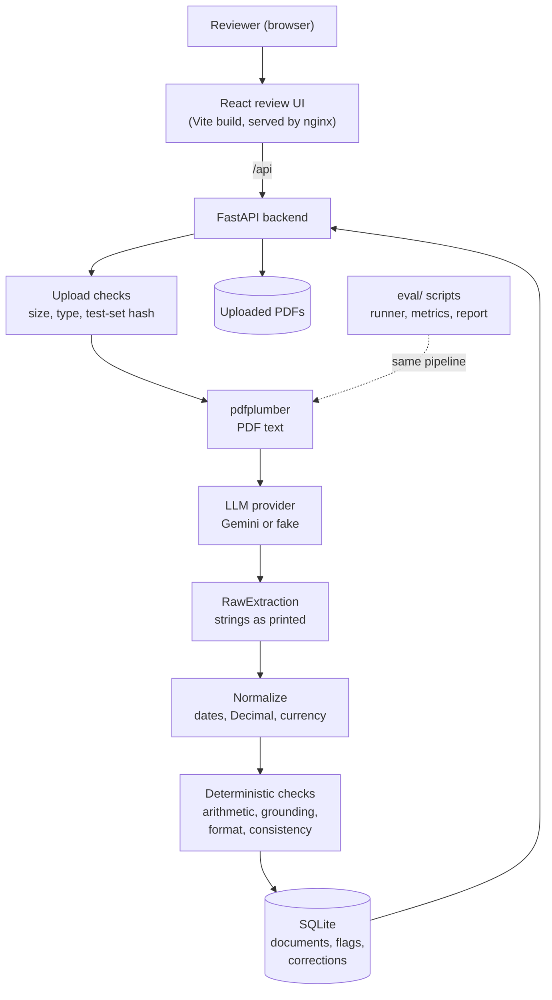

# Invoice Extraction with Human Review

[](https://github.com/Sarthak-1729/invoice-extraction-review/actions/workflows/ci.yml)

Upload text-based PDF invoices, extract structured fields with an LLM, validate
them with Pydantic, flag risky fields with deterministic checks, and let a
person review, correct and approve the result before exporting it.

The point of the project is the review loop, not the model: the LLM only
copies strings from the document, deterministic code parses and checks them,
and anything the checks cannot confirm goes to a person. The model's own
confidence is never used.

**All documents in this repository are synthetic.** The invoices are generated
by `eval/generator/` from invented names (`.example` email domains, fictional
555 phone numbers). The reported results describe these synthetic invoices,
not real-world ones (see [Limitations](#limitations)).

## Screenshots

Document list with status and open flags:



Review screen: the PDF next to the flagged fields:



After approval: the document is locked and the correction is in the audit trail:



## Features

- **Upload checks:** extension, content type and `%PDF-` bytes must agree;
  size and page limits; duplicates detected by SHA-256; scanned PDFs (no text
  layer) and encrypted PDFs are refused with a clear message.
- **Two-layer extraction:** the LLM returns each value as printed
  (`RawExtraction`); `app/normalize.py` turns it into dates, `Decimal` money
  and ISO 4217 currency codes. Ambiguous values (`03/04/2026`, a bare `$`)
  are flagged, never guessed.
- **Deterministic flags:** arithmetic (line amounts, subtotal, total),
  grounding (the value must occur in the PDF text), formats and consistency.
  Each flag names its field and severity.
- **Untrusted PDF text:** the text is wrapped and labeled as data in the
  prompt, and every answer is validated with Pydantic.
- **Review UI:** the PDF next to the fields, flags linked to their fields,
  edits that re-run every check, an append-only corrections history, approval
  that locks the document, and retry/delete for failed extractions.
- **Export:** approved documents only, as JSON or CSV (one row per line item).
- **Accessibility:** landmarks, labels, full keyboard use, live status
  messages, visible focus and no meaning by color alone. The author's manual
  axe DevTools scan found 0 issues on each of the list, review and approved
  screens, and the frontend tests run axe-core on every screen state.
  Automated checks cannot find every accessibility problem.
- **Evaluation:** a frozen, hashed test set; the app refuses uploads of its
  PDFs; metrics, error analysis and report are generated by scripts.
- **Fake LLM provider:** no test needs an API key or the network.

## Architecture



In Docker, nginx serves the built UI and forwards `/api/` to the backend, so
the browser talks to one origin. The database and uploads live in the named
volume `app-data`. Design details: [docs/DESIGN.md](docs/DESIGN.md); metric
definitions: [docs/METRICS.md](docs/METRICS.md).

## Quick start with Docker

Needs Docker with Compose. From the repository root:

```powershell
Copy-Item .env.example .env
```

Edit `.env`: set `LLM_PROVIDER=gemini` and your `GEMINI_API_KEY` (or keep
`LLM_PROVIDER=fake` to try the UI without a key). Then:

```powershell
docker compose up --build -d --wait
```

Open http://localhost:8080 and upload a PDF from `eval/datasets/dev/pdf/`.

- Ports are published on localhost only. Change them with `FRONTEND_PORT`
  (default 8080) and `BACKEND_PORT` (default 8000) in `.env` or the shell.
- Settings and secrets come only from `.env`; nothing secret is built into
  the images. Compose sets the container paths for the database and uploads
  and keeps `ALLOW_TEST_SET_UPLOADS=false`.
- Both containers run as non-root users with read-only root filesystems.
- `docker compose down` stops the stack and keeps the data;
  `docker compose down -v` also deletes the database and uploads.

## Quick start without Docker (Windows)

**Python 3.11 only.** `backend/pyproject.toml` requires `>=3.11,<3.12` and
CI uses 3.11.9 (`backend/.python-version`). On Windows, `py` may default to a
newer Python, so name the version. From `backend/`:

```powershell
py -3.11 -m venv .venv
```

```powershell
.venv\Scripts\python.exe -m pip install -e ".[dev]"
```

Copy `.env.example` (repository root) to `.env` and fill it in, then start the
API (from `backend/`):

```powershell
.venv\Scripts\python.exe -m uvicorn app.main:app --port 8000
```

Review UI (from `frontend/`, Node 22.13+ or 24; CI uses 24.12.0 from
`frontend/.nvmrc`):

```powershell
npm ci
```

```powershell
npm run dev
```

Open http://localhost:5173. The UI calls the API at `VITE_API_URL`
(default `http://localhost:8000`; see `frontend/.env.example`). The API
accepts browser requests from the origins in `CORS_ORIGINS` (default: the
Vite dev server). Interactive API docs: http://localhost:8000/docs.

## Review workflow

1. **Upload** a PDF on the list page. Extraction runs during the upload.
2. The document gets a status:
   - `extracted`: no flags;
   - `needs_review`: at least one flag;
   - `failed`: extraction failed (the error is shown, with
     **Retry extraction** and **Delete**).
3. **Review**: open the document. The PDF is shown next to the fields; each
   flag links to its field, and each field shows the extracted text and the
   normalized value.
4. **Correct** a field by typing the value as it appears on the invoice and
   saving. Every check runs again, and the change is recorded in the
   corrections history (original value, corrected value, time).
5. **Approve.** If flags are still open, you must tick a box confirming that
   you checked them. An approved document is locked.
6. **Export** approved documents from the list page as JSON or CSV.

## API

All paths are under `/api`. Errors have the shape
`{"error": {"code": "...", "message": "..."}}`.

| Method and path | Purpose |
|---|---|
| `GET /api/health` | Liveness check |
| `POST /api/documents` | Upload (multipart field `file`), extract and validate. 201 on success; 409 `DUPLICATE` (a duplicate of a `failed` document returns it with 200 instead); 413 `FILE_TOO_LARGE`; 415 `NOT_A_PDF`; 422 for invalid, scanned, encrypted or too-long PDFs; 403 `TEST_SET_DOCUMENT` for held-out PDFs |
| `GET /api/documents?status=` | List documents, newest first, optionally by status |
| `GET /api/documents/{id}` | Raw and normalized fields, flags, corrections, error |
| `GET /api/documents/{id}/pdf` | The stored PDF (looked up by id only) |
| `POST /api/documents/{id}/retry` | Run extraction again on a `failed` document |
| `DELETE /api/documents/{id}` | Delete the document and its stored PDF |
| `PATCH /api/documents/{id}/fields` | `{"changes": [{"field_path", "value"}]}`; records corrections and re-validates |
| `POST /api/documents/{id}/approve` | `{"acknowledge_open_flags": true}` is required while flags are open |
| `GET /api/documents/{id}/corrections` | The corrections history |
| `GET /api/export?format=json` or `csv` | Approved documents only |

## Configuration

Set in `.env` at the repository root (copy `.env.example`). Never commit `.env`.

| Variable | Default | Meaning |
|---|---|---|
| `LLM_PROVIDER` | `fake` | `gemini`, or `fake` for tests and demos. `ollama` exists but is untested |
| `GEMINI_API_KEY` | (none) | Required for `gemini` |
| `GEMINI_MODEL` | (none; `.env.example` sets `gemini-3.5-flash-lite`) | Gemini model name |
| `GEMINI_MIN_INTERVAL_SECONDS` | `6` | Minimum seconds between Gemini requests (free-tier pacing) |
| `GEMINI_TIMEOUT_SECONDS` | `120` | Timeout per request |
| `GEMINI_MAX_OUTPUT_TOKENS` | `16384` | Output token limit |
| `GEMINI_THINKING_LEVEL` | model default | `minimal`, `low`, `medium` or `high` |
| `LLM_TRANSIENT_RETRIES` | `3` | Retries after 429, 503 and timeouts |
| `LLM_MAX_BACKOFF_SECONDS` | `60` | Longest wait between retries |
| `DATABASE_URL` | `sqlite:///./data/app.sqlite3` | Database (Docker overrides it) |
| `UPLOAD_DIR` | `./uploads` | Stored PDFs (Docker overrides it) |
| `MAX_UPLOAD_MB` | `10` | Upload size limit |
| `MAX_PAGES` | `20` | Page limit |
| `ALLOW_TEST_SET_UPLOADS` | `false` | Keep `false`: refuses uploads of held-out test PDFs |
| `CORS_ORIGINS` | Vite dev server | JSON list of allowed browser origins |
| `FRONTEND_PORT` / `BACKEND_PORT` | `8080` / `8000` | Docker Compose only: host ports |
| `VITE_API_URL` | `http://localhost:8000` | Frontend build setting (`frontend/.env.example`); Docker builds with `/` |

## Tests

No test calls a real LLM or needs an API key. Backend tests use the fake
provider with the network blocked; frontend tests inject a fake `api`
object into `App` and block `fetch`.

```powershell
cd backend
.venv\Scripts\python.exe -m ruff check .
.venv\Scripts\python.exe -m ruff format --check .
.venv\Scripts\python.exe -m pytest --cov --cov-fail-under=96
cd ..
backend\.venv\Scripts\python.exe -m pytest eval
cd frontend
npm run lint
npm test
npm run build
```

CI (`.github/workflows/ci.yml`) runs the same steps on every push and pull
request, plus a check that the frozen test-set hash has not changed.

**ESLint is pinned to 9.39.5**, which ESLint has marked as no longer
supported (npm prints a deprecation warning). It stays on 9 because
`eslint-plugin-jsx-a11y` 6.10.2 does not yet declare support for ESLint 10;
the accessibility lint rules matter more here than the newer ESLint.

## Evaluation

- **Data:** 10 dev documents (used for prompt work) and 24 test documents
  (held out, never used for tuning), from different generator seeds. The test
  set and its truth files are committed and frozen; `eval/datasets/test/MANIFEST.sha256`
  is checked by CI, and any change must be logged in
  [`eval/TESTSET_CHANGELOG.md`](eval/TESTSET_CHANGELOG.md).
- **Dev check** (development aid, not a reported metric), from `backend/`:

  ```powershell
  .venv\Scripts\python.exe -m app.dev_check
  ```

- **Test-set run** (real Gemini, uses API quota; needs a clean git tree and
  the explicit flag), from the repository root:

  ```powershell
  backend\.venv\Scripts\python.exe -m eval.run_test --allow-test-set
  ```

  Then compute the metrics and the report for the run folder:

  ```powershell
  backend\.venv\Scripts\python.exe -m eval.metrics eval/results/test/<run folder>
  ```

  ```powershell
  backend\.venv\Scripts\python.exe -m eval.report eval/results/test/<run folder>
  ```

- **Metrics** follow [docs/METRICS.md](docs/METRICS.md) v1.1: layer 1
  compares the extracted string with the printed one, layer 2 compares the
  normalized value with the truth value; every percentage is shown with its
  counts.

## Results

These results are on synthetic documents from this repository's generator,
not on real invoices. The numbers below are generated from the committed
results file (`python -m eval.report <run folder> --readme`); none is typed
by hand, and a test fails if they drift from it.

<!-- generated:results -->
Baseline: one run of `extraction_v4` with `gemini-3.5-flash-lite` on the frozen 24-document test set (commit `f451523`, metric definitions v1.1, 24 of 24 documents scored). It was recorded before any fix and is the headline result; nothing was tuned on the test set. Full report: [`report.md`](eval/results/test/gemini-3.5-flash-lite__extraction_v4__852b70c465cb/report.md), notes: [`baseline.md`](eval/results/test/gemini-3.5-flash-lite__extraction_v4__852b70c465cb/baseline.md).

| Metric | Result |
|---|---|
| Field accuracy, end to end (layer 2, decided) | 94.4% (1548/1640), 4 ambiguous excluded |
| Field accuracy, end to end (layer 2, strict) | 94.2% (1548/1644) |
| Printed string copied exactly (layer 1) | 82.1% (1349/1644) |
| Documents with all 9 header fields right | 87.5% (21/24) |
| Documents fully right (header and every line) | 75.0% (18/24) |
| Line items fully right (recall) | 74.2% (265/357) |
| Ambiguous fields (flagged for review) | 4 (4 document, 0 induced) |
| Errors flagged for review (flag recall) | 0.0% (0/92) |
| Review items per document (mean) | 0.62 |

Errors by field: 92 description.
<!-- /generated:results -->

## Limitations

- **Synthetic data from one generator.** The dev and test sets come from the
  same generator (`eval/generator/`), so every reported number describes the
  synthetic test invoices in these four layouts, not real-world invoices. The
  baseline (`eval/results/test/`) says nothing about other layouts, fonts or
  scanned documents.
- **Prices are random.** Unit prices are drawn from a range per currency, so
  some are unrealistic (for example an office chair at CAD 7.98). The
  arithmetic is always internally consistent, which is what the metrics rely on.
- **Text-based PDFs only.** Scanned PDFs (no text layer) are rejected; there is
  no OCR.
- **Item codes in descriptions are not detected.** The grounding check only
  confirms that an extracted value occurs in the PDF text, so a value copied
  from the wrong place passes. This is reported as a known limitation; the
  prompt was not tuned further (see Future work).
  <!-- generated:item-codes -->
  Measured on the test-set baseline: 92 of 357 line-item descriptions came back as `<item code> <description>` (test-19: 43 of 43, test-20: 42 of 42, test-24: 7 of 38), and 0 of 92 errors were flagged. Item-code tables extracted correctly: test-22 (wrapped descriptions).
  <!-- /generated:item-codes -->
  The dev document with an item-code table (dev-09) also wraps; the tables
  that do not wrap failed. The causes are in the run's `baseline.md`.
- **Single runs vary.** The model's output is not fully repeatable: on one dev
  document the currency symbols on amounts were dropped in one run and kept
  in the next, with no relevant prompt change. Reported numbers therefore
  come from one specified run (model, prompt hash, git commit and date are
  recorded with every result), not from the best of several runs.
- **Prompt example matches the generator's reference format.** The active
  prompt tells the model to keep reference numbers "such as #1234" in
  descriptions, which is exactly the format the generator puts in every
  synthetic description. It was written to fix a dev document, but it also
  suits the test set (same generator), so the measured description accuracy
  may be overstated compared with real invoices, whose references look
  different.
- **Fonts.** The generator uses the built-in Helvetica/Courier fonts, which have
  no `₹` glyph, so INR amounts are printed with `Rs.`.
- **Single user, local use.** There is no login or access control, and the
  stack is published on localhost only. Extraction runs inside the upload
  request, so a slow model response keeps the request open.
- **No database migrations.** The schema is created at startup; a schema
  change needs a migration tool (for example Alembic) before real data is kept.
- **Unpinned backend dependencies.** There is no lock file, so a new install
  or image build can resolve newer library versions than the ones tested.

## Future work

- **Item-code check (planned for project version 1.1, not implemented).** A
  deterministic post-check that flags a description starting with a token
  from a detected item-code column. A column counts as detected only when
  several lines (at least 3, and at least half) start with distinct tokens
  of one shared shape that are also the first token of their text line, so a
  single description like "A4 copy paper" is not flagged; it only adds a
  warning and never edits a value. Conditions before any claim about it:
  a fresh held-out set (new generator seeds, never used for tuning,
  committed and hashed before the check is written), acceptance criteria
  written down before the run, a before/after comparison with the current
  prompt on that fresh set (the v4 baseline above stays as reported), and
  the hand-made set in `eval/handmade/`. The current test set has informed
  this idea, so it cannot be used to judge it.
- **Friendlier oversize message.** Uploads above the nginx limit get nginx's
  own 413 page, which the UI shows as a generic error.
- **Build the Docker images in CI.**

## License

[MIT](LICENSE) © 2026 Sarthak Shukla
